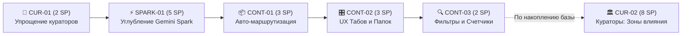

# 🗺️ Карта задач и архитектурная ревизия: Gemini Spark, Контейнеры и Кураторы

> **Статус**: Принято к реализации (Sprint Backlog & Vision 2026)  
> **Проект**: Lemon Calendarium / Project Lenta  
> **Фокус ревизии**: Упрощение архитектуры, заморозка сложной логики кураторов, усиление конвейера Gemini Spark и полировка контейнерно-табовой организации контента.

---

## 1. Стратегическая ревизия (Architecture Pivot)

```
┌─────────────────────────────────────────────────────────────────────────────┐
│                             ТЕКУЩИЙ КОНВЕЙЕР                                │
├────────────────────────────────┬────────────────────────────────────────────┤
│ ⚡ Автономные боты Gemini Spark │ 📦 Контейнеры, Табы и Папки                 │
│ • Стабильная генерация .md     │ • Четкая сортировка (Tabs & Folders)       │
│ • Авто-инжест из папок/диска   │ • Компактное представление без шума        │
│ • Минимум рутины для юзера     │ • Понятная изоляция контекстов             │
└────────────────────────────────┴────────────────────────────────────────────┘
                                        │
                                        ▼ (В будущем, при накоплении массы Notes)
┌─────────────────────────────────────────────────────────────────────────────┐
│                      🏛️ КУРАТОРЫ 2.0: ЗОНЫ ВЛИЯНИЯ                          │
├─────────────────────────────────────────────────────────────────────────────┤
│ • Анализ уже накопленного массива заметок (Notes Graph)                     │
│ • Авто-классификация заметок и соотнесение со своей зоной влияния           │
│ • Выявление белых пятен и доменных связей (IT, Геополитика, Экономика)     │
└─────────────────────────────────────────────────────────────────────────────┘
```

### 1.1. Выводы ревизии:
1. **Генерация контента через Gemini Spark доказала свою эффективность**:
   - Автономные боты автономно поставляют качественный структурированный материал.
   - Механизм инжеста через `SparksParserService` и Google Drive показал высокий ROI.
   - Требуется углубление этой интеграции вместо поддержки самописных громоздких генераторов.
2. **Контейнерная модель (Tabs & Folders) закрывает проблему навигации**:
   - Разбиение на табы и папки (Obsidian Containers / Feeds) компактно, интуитивно и не дает пользователю потеряться в потоке данных.
   - Это приоритетное UX-направление, требующее дальнейшей шлифовки.
3. **Решение по Кураторам**:
   - **Сейчас**: Отказываемся / замораживаем сложную логику интерактивных кураторов (опросы, коллегии, тяжелые цепочки генерации мнений) ради радикального снижения когнитивной и архитектурной сложности.
   - **В будущем**: Возвращаем кураторов не как «инструмент создания контента», а как **агентов классификации зон влияния**. Когда база наполнится тысячами заметок, кураторы будут проводить ретроспективный анализ, соотносить заметки со своими сферами ответственности и формировать срезы знаний.

---

## 2. Сводная карта задач (Story Points & Backlog)

Для оценки используется стандартная шкала Фибоначчи: **1, 2, 3, 5, 8 SP**.

| ID | Задача | Категория | SP | Приоритет | Горизонт |
| :--- | :--- | :--- | :---: | :---: | :---: |
| **SPARK-01** | **Расширение интеграции с Gemini Spark** | Backend / Ingestion | **5** | 🟢 High | Ближайший / Средний |
| **CONT-01** | **Авто-маршрутизация заметок Spark по контейнерам и табам** | Core / Workflow | **3** | 🟢 High | Ближайший |
| **CONT-02** | **Полировка UX контейнеров, табов и папок (Compact Feed View)** | Frontend / UX | **3** | 🟡 Medium | Ближайший |
| **CUR-01** | **Консервация и упрощение текущей кураторской логики** | Architecture / Refactor | **2** | 🟢 High | Немедленно |
| **CONT-03** | **Быстрые фильтры и счетчики непрочитанного внутри табов** | Frontend / State | **2** | 🟡 Medium | Средний |
| **CUR-02** | **[Future] Кураторы как классификаторы зон влияния Notes** | AI / Agents | **8** | 🔵 Future Vision | Долгосрочный |

**Итого в активном пуле**: **15 SP**  
**Будущий горизонт (Кураторы 2.0)**: **8 SP**

---

## 3. Детализация задач

### ⚡ SPARK-01: Расширение интеграции с Gemini Spark
- **Оценка**: `5 Story Points`
- **Цель**: Превратить входящий поток от ботов Gemini Spark в масштабируемый, отказоустойчивый и обогащенный конвейер.
- **Состав работ**:
  1. Поддержка многопоточного мониторинга входящих директорий (локальных и облачных) с дедупликацией.
  2. Расширенный парсинг метаданных во фронтматтере (структурированные теги, приоритеты, первоисточники, ссылки).
  3. Двусторонняя верификация инжеста (статусы доставки, валидация Markdown-синтаксиса перед записью в БД).
  4. Автономная генерация дайджестов изменений за сутки на базе Sparks.
- **Definition of Done (DoD)**:
  - Любой новый `.md` от Spark автоматически проходит валидацию, парсится и появляется в ленте с присвоением корректного типа источника.
  - Покрыто интеграционными тестами (`scripts/test-sparks-ingestion.mjs`).

---

### 📦 CONT-01: Авто-маршрутизация заметок Spark по контейнерам и табам
- **Оценка**: `3 Story Points`
- **Цель**: Полная автоматизация раскладки заметок по соответствующим контейнерам и вкладкам без ручных действий.
- **Состав работ**:
  1. Декларативные правила сопоставления тегов/категорий Spark с контейнерами Obsidian (`ObsidianContainer`).
  2. Автоматическое распределение по структуре папок (например, `/IT/AI-Sparks/`, `/Macro/Reports/`).
  3. Сохранение привязки к `UnifiedFeedTab` при чтении в веб-приложении.
- **Definition of Done (DoD)**:
  - Поступающая заметка Spark сразу отображается в соответствующем табе ленты и в привязанной папке контейнера.

---

### 🎛️ CONT-02: Полировка UX контейнеров, табов и папок (Compact Feed View)
- **Оценка**: `3 Story Points`
- **Цель**: Максимально компактное, интуитивное представление информации без визуального шума.
- **Состав работ**:
  1. Компактный режим отображения списка заметок в табах (быстрый скан заголовков, времени и тегов).
  2. Мягкая группировка по датам и источникам внутри активного таба.
  3. Удобное переключение между контейнерами без перезагрузки контекста.
- **Definition of Done (DoD)**:
  - Пользователь видит плотный информативный список без избыточных карточек, легко ориентируется между вкладками.

---

### 🧹 CUR-01: Консервация и упрощение текущей кураторской логики
- **Оценка**: `2 Story Points`
- **Цель**: Снять архитектурный оверхед и убрать неиспользуемую сложность кураторских коллегий из активных путей исполнения.
- **Состав работ**:
  1. Отключение тяжелых цепочек взаимного опроса кураторов и синтеза мнений из обязательного пайплайна.
  2. Сохранение кураторских идентификаторов как пассивных тегов авторства / оптики (без блокирующих резолверов).
  3. Упрощение UI: скрытие громоздких элементов вызова коллегий, фокус интерфейса на контенте и табах.
- **Definition of Done (DoD)**:
  - Кодовая база избавлена от лишней связности; создание и просмотр заметок не зависят от кураторских агентов.
  - Сохранены типы данных для обратной совместимости (`@lenta/shared`).

---

### 🔍 CONT-03: Быстрые фильтры и счетчики непрочитанного внутри табов
- **Оценка**: `2 Story Points`
- **Цель**: Удобная навигация по входящим обновлениям без потери фокуса.
- **Состав работ**:
  1. Отображение бейджей количества новых заметок на табах и папках.
  2. Локальное сохранение временной метки посещения таба (`lastVisitedTimestamp`).
  3. Быстрый фильтр "Только непрочитанные" в один клик.
- **Definition of Done (DoD)**:
  - Юзер мгновенно видит, в каком табе появились новые материалы от Spark, и может сбросить счетчик при просмотре.

---

### 🏛️ CUR-02: [Future Milestone] Кураторы как классификаторы зон влияния Notes
- **Оценка**: `8 Story Points`
- **Цель**: Переосмысление кураторов как доменных аналитиков зрелой базы знаний.
- **Состав работ**:
  1. Алгоритм батчевого семантического анализа массива накопленных заметок.
  2. Маппинг заметок на зоны влияния (Иван Белый — Внутренняя политика/Регуляторика; Окация — IT/AI Архитектура; Kirk Kitten — Внешние рынки и санкции).
  3. Построение доменных срезов знаний, матрицы покрытия тем и выявление дефицита информации по направлениям.
- **Definition of Done (DoD)**:
  - Автономный процесс сканирует существующий граф Notes и формирует отчет по зонам влияния с распределением материалов по кураторам.

---

## 4. Порядок реализации (Execution Steps)



1. **Фаза 1: Очистка и разгрузка (Sprint 1)**
   - Выполнить **CUR-01** (2 SP): заморозить сложную логику, облегчить систему.
   - Запустить **SPARK-01** (5 SP): расширить прием контента от ботов Gemini Spark.
2. **Фаза 2: Контейнерное совершенствование (Sprint 2)**
   - Реализовать **CONT-01** (3 SP) и **CONT-02** (3 SP): бесшовная раскладка заметок Spark по табам и компактный UI.
   - Добавить **CONT-03** (2 SP): счетчики обновлений.
3. **Фаза 3: Долгосрочная перспектива (Future Horizon)**
   - При накоплении критической массы контента вернуться к **CUR-02** (8 SP) для умной классификации зон влияния.
