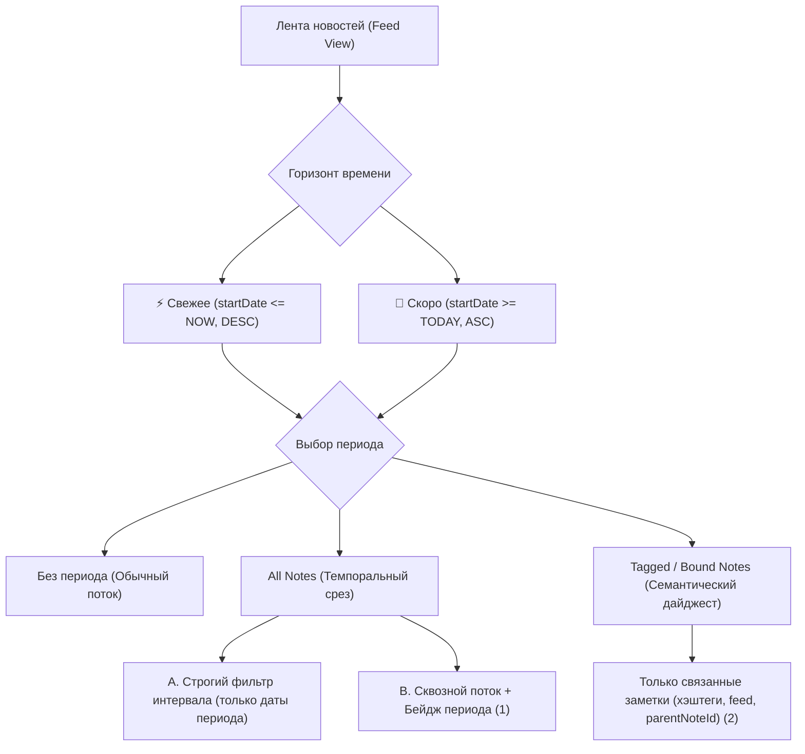
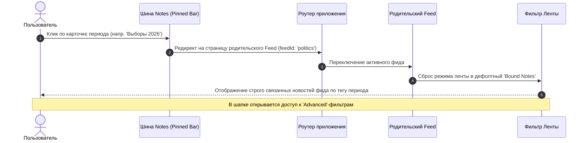
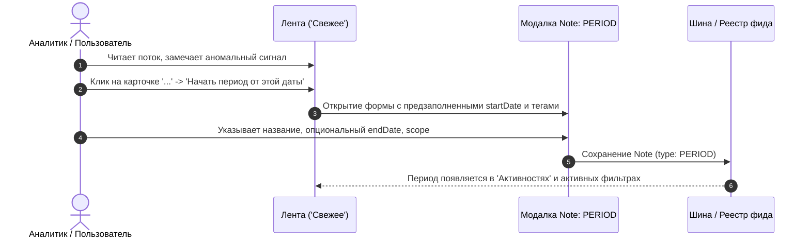

# 🍋 Lemon Calendarium — Спецификация Горизонтов Ленты, Периодов и Матрицы Состояний Фильтров

> **Статус**: Архитектурный стандарт / Принято к реализации  
> **Версия**: 1.3.0  
> **Дата**: 30 октября 2026 г.  
> **Область действия**: `apps/feed-app`, `apps/calendar-app`, `apps/backend`, `packages/shared`

---

## 📑 Содержание

1. [Философия и цели](#1-философия-и-цели)
2. [Базовая модель данных: Period как Note](#2-базовая-модель-данных-period-как-note)
3. [Матрица состояний фильтров ленты](#3-матрица-состояний-фильтров-ленты)
4. [Взаимодействие с шиной Notes (Клик, Редирект, Сброс)](#4-взаимодействие-с-шиной-notes-клик-редирект-сброс)
5. [Мульти-выбор периодов и отображение микро-тегов](#5-мульти-выбор-периодов-и-отображение-микро-тегов)
6. [Секция «Активности канала» (Feed Activities)](#6-секция-активности-канала-feed-activities)
7. [Сценарий: Обнаружение аномалий и фиксация периода](#7-сценарий-обнаружение-аномалий-и-фиксация-периода)
8. [Note как Менеджер Состояния и Темпоральная Математика](#8-note-как-менеджер-состояния-и-темпоральная-математика)
9. [Жизненный цикл открытых периодов и семантика завершённых](#9-жизненный-цикл-открытых-периодов-и-семантика-завершённых)
10. [Разделение контуров: Публичный vs Приватный](#10-разделение-контуров-публичный-vs-приватный)

---

## 1. Философия и цели

Традиционные новостные агрегаторы страдают от **проблемы одномерного потока**:
- Будущие релизы (фильмы, конференции, праздники) смешиваются со свежими новостями сегодняшнего дня.
- Крупные смысловые контексты (выборы, запуски новых линеек моделей AI, кризисы) тонут в ежедневном потоке несвязанных сообщений.

**Решение Lemon Calendarium:**
1. Разделение временного горизонта на **«Свежее»** (что уже вышло/происходит) и **«Скоро»** (предстоящие даты и релизы).
2. Выделение **Периодов (`PERIOD`)** как смысловых контекстов первого класса.
3. Поддержка двух режимов обзора: **Темпорального** (`All Notes`) и **Семантического** (`Tagged / Bound Notes`).
4. Рассмотрение заметки (`Note`) как **динамического менеджера состояния**, на который накладываются вложенные и скользящие контексты.

---

## 2. Базовая модель данных: Period как Note

Период не требует отдельной сложной таблицы в БД. Он моделируется через стандартную сущность `Note`:

```prisma
// Фрагмент Note в prisma/schema.prisma:
model Note {
  id             String         @id @default(uuid())
  type           NoteType       @default(SINGLE) // SINGLE, PERIOD, EVENT, FILM_RELEASE, MENTION, DONE
  feedId         String?        // Родной фид периода (например, 'politics' или 'it-dev')
  startDate      DateTime       // Дата начала периода (точка отсчёта аномалии или события)
  endDate        DateTime?      // Дата завершения (null = открытый/продолжающийся период)
  status         NoteStatus     @default(PUBLISHED) // DRAFT, SCHEDULED, PUBLISHED, ARCHIVED
  parentNoteId   String?        // Связь с над-периодом или супер-событием
  childNotes     Note[]         @relation("NoteSynthesis") // Связанные дочерние публикации
  metadata       Json?          // Настройки шины, вещания, хэштеги периода, lastActivityAt
}
```

### Ключевые свойства:
- **Принадлежность фиду:** Период создается внутри своего канала (`feedId`), что предотвращает загрязнение чужих тем (кулинарные рецепты не попадают в политический период по умолчанию).
- **Связь через `NoteSynthesis`:** Публикации из других фидов могут явно ссылаться на период через `parentNoteId`.

---

## 3. Матрица состояний фильтров ленты

Пользователь управляет отображением через комбинацию **Горизонта времени** и **Селектора периодов**:



---

## 4. Взаимодействие с шиной Notes (Клик, Редирект, Сброс)

Когда в глобальной или локальной шине отображается запиненный период, клик по нему запускает строго выверенный сценарий:



### Правила перехода:
1. **Автоматический редирект:** При клике на период пользователь перемещается в **родной фид** этого периода (например, выбор периода «Выборы 2026» в общей шине сразу переключает вкладку на фид *«Политика РФ»*).
2. **Сброс в `Bound Notes`:** При любом выборе периода из шины состояние отображения принудительно сбрасывается в **`Bound Notes`** (семантическая привязка), чтобы пользователь сразу увидел суть события без шума.
3. **Разблокировка Advanced-фильтров:** После перехода пользователю открываются расширенные аналитические инструменты, где он может вручную переключиться в режим `All Notes` (широкий срез дат с бейджами).

---

## 5. Мульти-выбор периодов и отображение микро-тегов

Пользователь в аналитическом режиме может выбрать **одновременно несколько периодов** (например, *«Выборы 2026»* + *«Саммит БРИКС»*).

### Правила рендеринга карточек:
1. **Объединение множеств:** В ленту попадают новости, связанные хотя бы с одним из выбранных периодов (логическое `OR`).
2. **Компактные микро-теги:** На карточке новости отображаются миниатюрные чипы активных периодов.
3. **Правило переполнения (Overflow Controller):**
   - На карточке отображается максимум **до 3 микро-тегов**.
   - Если новость подпадает под $>3$ периодов, отображаются первые 3 + контроллер троеточия `...` (или `+N`).
   - При наведении (hover) или клике на троеточие всплывает аккуратный поповер/тултип с полным списком периодов и их хронологией (какой период начался раньше, какой длится дольше, вложенные интервалы).

---

## 6. Секция «Активности канала» (Feed Activities)

Для периодов, которые **не вынесены в глобальную шину**, естественной средой обитания является карточка канала (`FeedDesktopRail` на десктопе, горизонтальная карусель чипов на мобильных устройствах).

### Представление в UI:
1. **Десктоп:** Вертикальный блок в правом сайдбаре `FeedDesktopRail` внутри карточки «О канале / ленте».
2. **Мобильные устройства:** **Горизонтальная скролл-карусель чипов (Horizontal Scroll Chip Carousel)** прямо под шапкой фида:
   ```
   [ 🟢 Выборы 2026 (42) ]  [ 🟢 AI Wave (18) ]  [ ⏳ Скоро: I/O ]  [ ⚪ Архив... ]
   ```
   * Поддерживает плавный горизонтальный свайп с эффектом затухания краёв (fade edges) и тактильным откликом.
   * Активный выбранный период подсвечивается акцентным цветом фида.

### Структура секции:
- **Заголовок:** `⚡ Активности канала (N)`
- **Элементы списка / чипы карусели:**
  - `🟢 [Идёт сейчас]` — период, где `startDate <= NOW` и (`endDate >= NOW` или `endDate == null`).
  - `⏳ [Скоро]` — предстоящий период (`startDate > NOW`).
  - `⚪ [Завершен]` — исторический период, сохранённый для архива.
- **Взаимодействие:** Клик/тап по элементу активности мгновенно включает фильтрацию ленты по данному периоду (в режиме `Bound Notes` с возможностью переключения в `All Notes + Бейдж`).

---

## 7. Сценарий: Обнаружение аномалий и фиксация периода

Главная ценность для аналитика — возможность перевести разовые сигналы в оформленный период:



---

## 8. Note как Менеджер Состояния и Темпоральная Математика

По ходу развития архитектуры заметка перестаёт быть плоской строкой текста и становится **актором и менеджером состояния во времени**:

```
                 ТЕМПОРАЛЬНАЯ МАТРИЦА ЗАМЕТКИ (STATE VECTOR)
  
   Время t: ──────────────────────[ t_новость ]────────────────────────►
   
   Макро-период:   [═══════════ Осенний сезон 2026 ═══════════] (Status: ACTIVE)
   Микро-период:          [════ Выборы 2026 ════]              (Status: ACTIVE)
   Скользящее окно:              [░░░ Окно 7 дней ░░░]         (Rolling Resonance)
   Завершенный период: [══ Прекампейн ══]                      (Status: CLOSED)
```

### Математический пайплайн (Functional Pipeline):
Состояние и вес любой позиции/новости в системе вычисляются через композицию чистых функций:

$$\text{EvaluatedNote} = (\text{withPinnedContext} \circ \text{withResonanceWeight} \circ \text{withNestedPeriods})(Note)$$

1. **Вложенные периоды (Nested Periods):** Заметка осознаёт, в какой макро-контекст и микро-контекст она погружена.
2. **Скользящие Note (Rolling Windows):** Вычисление динамики (скользящее среднее резонанса за окно в 3 / 7 / 30 дней вокруг даты новости).
3. **Память завершённых периодов:** Завершившийся период не исчезает в небытие; в аналитике он выступает как завершённая фаза, позволяя ретроспективно оценивать, какие события привели к закрытию фазы.

---

## 9. Жизненный цикл открытых периодов и семантика завершённых

### А. Таймер спящего режима (Dormancy Timer: 7–10 дней)
Для открытых периодов (`endDate = null`):
- Система отслеживает метку последнего события/связанной заметки (`lastActivityAt`).
- Если в течение **7–10 календарных дней** по теме периода не появляется новых заметок, период автоматически переводится в статус **`DORMANT`** (или завершается с фиксацией `endDate` по дате последней публикации).
- Период аккуратно уходит из секции *«🟢 Идёт сейчас»* в архив *«⚪ Завершённые»*, освобождая место для новых контекстов.

### Б. Завершённый период как Parent Note для будущих событий
- **Временной интервал закрыт:** В хронологический срез завершённого периода не попадают будущие или запланированные новости (`status: SCHEDULED`).
- **Семантическая гравитация сохраняется:** Завершённый период может продолжать выступать в роли **`parentNoteId`** для запланированных или ретроспективных материалов (например: запланированный через месяц документальный фильм по итогам прошедших выборов, круглый стол или аудит).
- Таким образом, семантическое дерево не ломается от факта календарного завершения периода.

### В. Поведение фильтра `All Notes` при выбранном периоде
- Выбор периода под фильтром **`All Notes` не отматывает время назад** и не сбивает текущий скролл пользователя.
- Фильтр `All Notes` в этом состоянии работает как **сквозной подсвечивающий луч (Ambient Lens)**: он оставляет актуальную ленту новостей как есть, лишь подсвечивая релевантные карточки специальным бейджем выбранного периода.

---

## 10. Разделение контуров: Публичный vs Приватный

| Аспект | Публичный контур («Голый UI») | Приватный контур (Аналитика) |
| :--- | :--- | :--- |
| **Сложность UI** | Минимальная: только чтение, чип «Главная тема дня» | Полная: конструктор фильтров, создание периодов |
| **Управление периодами** | Только просмотр утверждённых редакцией тем | Создание, редактирование, закрытие, связывание |
| **Селектор режима** | Фиксирован на `Bound Notes` | Свободное переключение: `All Notes (Ambient)` $\leftrightarrow$ `Bound Notes` |
| **Мульти-выбор** | 1 выбранная тема | Мульти-выбор периодов, пересечения, цепочки фильтров |
| **Активности фидов** | Доступны в боковом меню для быстрого погружения | Полное редактирование дат, статусов и архивация |
| **Затухание периода** | Автоматически скрываются спящие темы | Тонкая настройка порога затухания (7–10 дней) |
